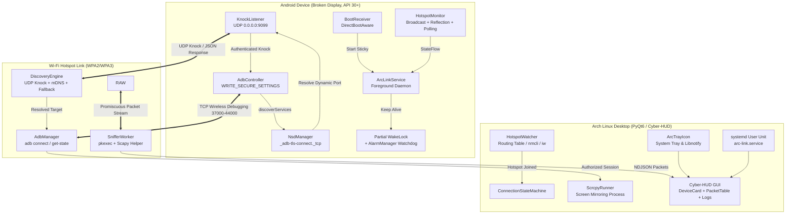

# ARC-LINK System Architecture

ARC-LINK is an autonomous zero-touch wireless recovery bridge designed for Android devices with broken displays connected to an Arch Linux workstation.

---

## 1. High-Level Architecture Diagram



---

## 2. 4-Step State Machine Protocol

```mermaid
sequenceDiagram
    autonumber
    participant Phone as Android Phone (Broken Screen)
    participant AP as Wi-Fi Hotspot (ap0)
    participant Laptop as Arch Linux Laptop (Client)
    participant Desktop as arc-link Desktop App

    Note over Phone,Desktop: Phase 1: Reboot & Autostart
    Phone->>Phone: Device Reboots / Boot Completed
    Phone->>Phone: BootReceiver triggers ArcLinkService
    Phone->>Phone: ArcLinkService acquires partial WakeLock & listens on UDP 9099

    Note over Phone,Desktop: Phase 2: Hotspot & Laptop Join
    Phone->>AP: Hotspot turns ON (SSID: AndroidAP, IP: 192.168.43.1)
    Laptop->>AP: Laptop connects to Wi-Fi Hotspot
    Desktop->>Desktop: HotspotWatcher detects gateway 192.168.43.1
    Desktop->>Phone: UDP "ARCX-KNOCK:<shared_secret>" to 192.168.43.1:9099
    Phone->>Phone: Knock accepted; AdbController writes adb_wifi_enabled=1
    Phone->>Phone: NsdManager resolves dynamic TLS port (e.g., 39451)
    Phone-->>Desktop: JSON: {device_name, model, ip, adb_port: 39451, battery}
    Desktop->>Phone: adb connect 192.168.43.1:39451
    Desktop->>Phone: adb -s 192.168.43.1:39451 get-state -> 'device'
    Desktop->>Phone: scrcpy launched (Screen Mirrored!)

    Note over Phone,Desktop: Phase 3: Hotspot Turned OFF
    Phone->>AP: Hotspot toggled OFF
    Phone->>Phone: HotspotMonitor detects loss
    Phone->>Phone: AdbController disables adb_wifi_enabled=0

    Note over Phone,Desktop: Phase 4: Laptop Loss & Disconnect
    Desktop->>Desktop: HotspotWatcher detects route deletion
    Desktop->>Desktop: Scrcpy process terminated cleanly
    Desktop->>Desktop: adb disconnect 192.168.43.1:39451
    Desktop->>Desktop: UI updates to DISCONNECTED + Desktop Notification
```

---

## 3. Security and Privilege Separation

1. **Android App (No Root Required):**
   - Requires one-time `android.permission.WRITE_SECURE_SETTINGS` permission granted via ADB cable while the screen works or during setup.
   - Restricts UDP knock acceptance to requests originating from local private hotspot subnet (`192.168.43.x`, `192.168.49.x`, `10.x.x.x`).
   - Validates incoming payload prefix and cryptographic shared secret string before modifying system settings.
   - Immediately turns off Wireless Debugging when hotspot shuts down to prevent exposed ports on public Wi-Fi networks.

2. **Desktop Linux App (Least Privilege via Polkit):**
   - Main GUI runs entirely as unprivileged standard desktop user.
   - Raw packet sniffing is isolated into `/usr/lib/arc-link/arc-link-sniffer`, executed via PolicyKit (`pkexec`) under `org.arclink.sniffer.policy`.
   - Streaming between privileged helper and GUI is serialized as strict newline-delimited JSON over UNIX pipe with non-blocking readline.
